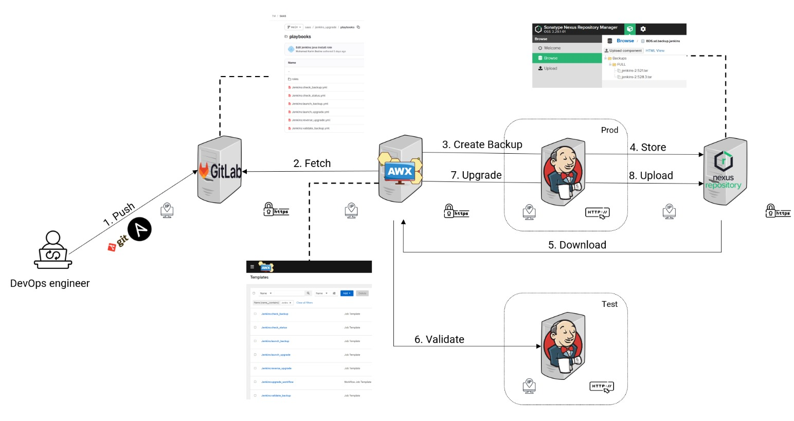
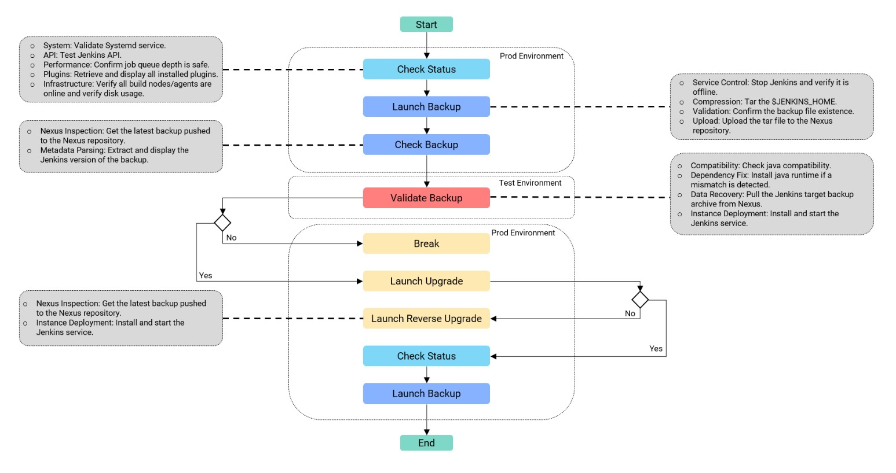
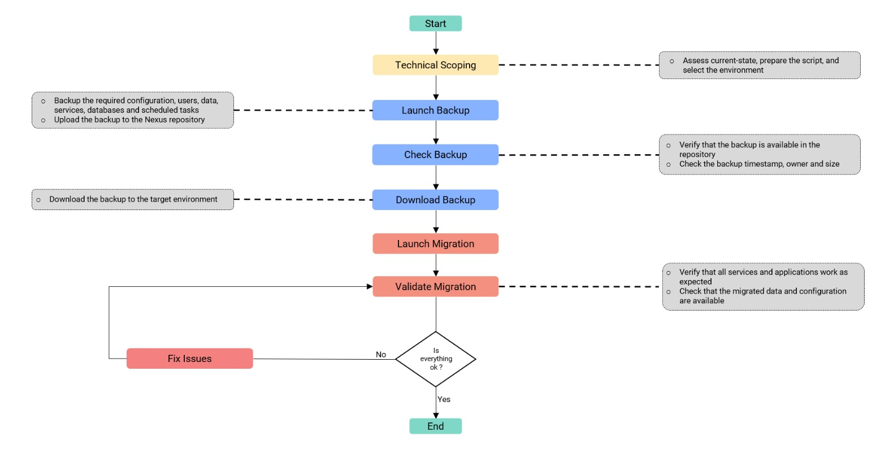

# Bull SRE & DevOps – Jenkins Upgrade & OS Migration Automation

End-of-studies project carried out at **Bull** within the **Tools & Methods** team (Server Design department).

The project automates the **upgrade cycle of Jenkins** and the **migration of the system that hosts it**, so that upgrades are reliable, reproducible, traceable and do not interrupt the services that depend on Jenkins.

> **Problem statement:** How can we automate and make reliable the upgrade operations of Jenkins and its system environment, while guaranteeing reproducible processes, risk control and service continuity?

---

## 🎯 Objectives

- Automate Jenkins and OS upgrades with **Ansible**
- Run **post-upgrade tests** and validate every backup before upgrading
- Provide **rollback** to the last stable version when an upgrade fails
- Guarantee **traceability and documentation** of each step
- Migrate the hosting VM from **CentOS 8** (end of support) to **Rocky Linux 10**

---

## ⚙️ How It Works



A DevOps engineer develops the Ansible playbooks and pushes them to GitLab. AWX fetches them and orchestrates their execution against the production and test Jenkins machines, with Nexus used as the backup store.

| Step | Action | Description |
|------|--------|-------------|
| 1 | **Push** | The DevOps engineer pushes the Ansible playbooks to GitLab |
| 2 | **Fetch** | AWX fetches the playbooks from GitLab |
| 3 | **Create Backup** | AWX triggers a backup of the Jenkins instance on the **Prod** machine |
| 4 | **Store** | The backup is pushed to the Nexus repository |
| 5 | **Download** | The backup is downloaded from Nexus to the **Test** machine |
| 6 | **Validate** | The backup is restored and validated on the Test machine |
| 7 | **Upgrade** | The upgrade is applied on the Prod machine |
| 8 | **Upload** | A backup of the newly upgraded instance is uploaded to Nexus |

---

## 🔄 Jenkins Upgrade Workflow



The workflow runs across two environments (**Prod** and **Test**) and is split into the following stages:

| Stage | Environment | What it does |
|-------|-------------|--------------|
| **Check Status** | Prod | Validates the systemd service, tests the Jenkins API, confirms the job queue depth is safe, lists installed plugins, verifies that all build nodes/agents are online and checks disk usage |
| **Launch Backup** | Prod | Stops Jenkins and verifies it is offline, compresses `$JENKINS_HOME` into a tar archive, confirms the archive exists and uploads it to Nexus |
| **Check Backup** | Prod | Gets the latest backup pushed to Nexus and extracts/displays its Jenkins version |
| **Validate Backup** | Test | Checks Java compatibility (installs the Java runtime if there is a mismatch), pulls the backup archive from Nexus, installs and starts Jenkins |
| **Launch Upgrade** | Prod | Runs only if the backup validation succeeded, otherwise the workflow **breaks**. Installs the target version and restarts the service |
| **Launch Reverse Upgrade** | Prod | Runs if the upgrade failed: fetches the latest stable backup from Nexus and redeploys Jenkins (rollback to version N-1) |
| **Check Status** + **Launch Backup** | Prod | If the upgrade succeeded, status is checked again and a new backup of the upgraded instance is created |

**Version strategy:** the existing instance ran a *Weekly* release (**2.521**). Weekly releases are great for testing new features but offer limited stability and no backporting, so the upgrade also switches to the **Long Term Support (LTS)** line, targeting **2.528.3 LTS**.

---

## 🖥️ OS Migration Workflow



The second part of the project modernizes and secures the Jenkins hosting environment by migrating it to **Rocky Linux 10**. The workflow follows the same logic as the Jenkins upgrade:

| Stage | What it does |
|-------|--------------|
| **Technical Scoping** | Assesses the current state, prepares the script and selects the environment |
| **Launch Backup** | Backs up configuration, users, data, services, databases and scheduled tasks, then uploads the backup to Nexus |
| **Check Backup** | Verifies the backup is available in the repository and checks its timestamp, owner and size |
| **Download Backup** | Downloads the backup to the target environment |
| **Launch Migration** | Runs the migration on the target |
| **Validate Migration** | Verifies services and applications work as expected and that migrated data and configuration are available |
| **Fix Issues** | If something is not OK, issues are fixed and the validation is run again until everything passes |

### Environment inventory

| | Source VM | Target VM |
|---|-----------|-----------|
| **OS** | CentOS 8 | Rocky Linux 10.2 |
| **CPU** | 8 CPUs, Xeon Gold 6240L @ 2.60 GHz | 4 CPUs, Xeon Platinum 8268 @ 2.90 GHz |
| **RAM** | 16 GB | 16 GB |
| **Root disk** | 200 GB (41% used) | 495 GB |
| **Packages / active services** | 1326 / 58 | n/a |

---

## 📁 Repository Structure

```
.
├── jenkins_upgrade/     # Ansible playbooks for the Jenkins upgrade workflow
├── OS_migration/        # OS migration from CentOS 8 to Rocky Linux 10
├── assets/              # Workflow diagrams used in this README
└── README.md
```

---

## 🧰 Tech Stack

| Area | Tools | Why |
|------|-------|-----|
| Automation | **Ansible** | Agentless (only Python needed on targets), idempotent playbooks written in YAML |
| Orchestration | **AWX** | Centralizes playbooks, orchestrates workflows and schedules executions |
| Versioning | **GitLab** | Versioning and traceability of playbooks through commits and pushes, team collaboration |
| Artifact storage | **Nexus Repository** | Stores Jenkins backups and the migration backups |
| Testing | **Selenium** | Post-upgrade tests, integrated with CI/CD tools |
| CI/CD | **Jenkins** | The platform being upgraded |
| Operating system | **RHEL-family Linux** (CentOS 8 → Rocky Linux 10) | Hosting environment |
| Scripting & runtime | Bash, Python, Java | Scripts, Ansible requirement, Jenkins runtime |

---

## 📋 Requirements

### Hardware (Jenkins)

| Level | RAM | Storage |
|-------|-----|---------|
| Minimum | 256 MB | 1 GB (10 GB if Jenkins runs in a Docker container) |
| Recommended (small team) | ≥ 4 GB | ≥ 50 GB |
| Optimal | Depends on usage (pipelines, plugins, users, agents) | |

Best practice: set the Jenkins controller to **0 executors** and delegate all builds to agents to avoid overload.

### Software

- Red Hat Enterprise Linux family OS
- Java (compatible with the targeted Jenkins version) and Python
- Bash
- Git and GitLab
- Nexus Repository
- Ansible and AWX
- Selenium with a browser (post-upgrade tests)

---

## 🚀 Getting Started

1. **Clone the repository**
   ```bash
   git clone https://github.com/medkarim19/bull-sre-devops.git
   cd bull-sre-devops
   ```
2. **Push the playbooks to GitLab** so they can be versioned and tracked.
3. **Configure AWX** with a project pointing to the GitLab repository, the inventories for the Prod and Test machines, and the job templates for each stage (check status, launch backup, check backup, validate backup, launch upgrade, reverse upgrade).
4. **Chain the job templates into an AWX workflow** following the Jenkins Upgrade Workflow above.
5. **Run the workflow** from AWX (manually or scheduled). Use the same approach for the OS migration workflow.

---

## ✅ Results

- Reliable, reproducible and traceable Jenkins upgrades
- Backups validated on a test machine before touching production
- Automatic rollback to the last stable version on failure
- Hosting environment moved from an unsupported OS to Rocky Linux 10
